<div align="center">

<picture>
  <source media="(prefers-color-scheme: dark)" srcset="assets/pushfps-logo-animated-dark.png">
  <source media="(prefers-color-scheme: light)" srcset="assets/pushfps-logo-animated-light.png">
  
</picture>

<sub>Glide is a fork of <a href="https://github.com/DosukaSOL/PushFPS">PushFPS</a> by DosukaSOL, built on <a href="https://github.com/Likely7/Veyra-NRVideo">Veyra</a> by Likely7.</sub>

### Play 30 FPS console games at 60 or 120 FPS on your PC monitor.

Glide takes the picture from your capture card and adds AI-generated frames in real time.<br>
Nothing changes on the console or in the game: you need a capture card and a graphics card.

[](https://github.com/Omar-Raslan-16006931/Glide/releases)
&nbsp;
[](#linux-and-macos-preview)
&nbsp;
[](#obs-studio-plugin)
&nbsp;
[](https://dosukasol.github.io/Glide/)

[](https://github.com/Omar-Raslan-16006931/Glide/releases)
[](https://github.com/DosukaSOL/PushFPS/actions/workflows/build-windows.yml)
[](LICENSE)
[](https://github.com/Likely7/Veyra-NRVideo)

<table>
  <tr>
    <td align="center" width="300">
      <a href="https://github.com/Likely7/Veyra-NRVideo"></a><br>
      <sub>Built on <a href="https://github.com/Likely7/Veyra-NRVideo"><b>Veyra</b></a> by <a href="https://github.com/Likely7">Likely7</a></sub>
    </td>
    <td align="center" width="300">
      <a href="https://github.com/apex-compute/ANR"><b>Apex Neural Rendering (ANR)</b></a><br>
      <sub>ANR frame generation by <a href="https://github.com/apex-compute/ANR"><b>Apex Neural Rendering</b></a> from <a href="https://apexcompute.com">Apex Compute</a></sub>
    </td>
  </tr>
</table>

<br>

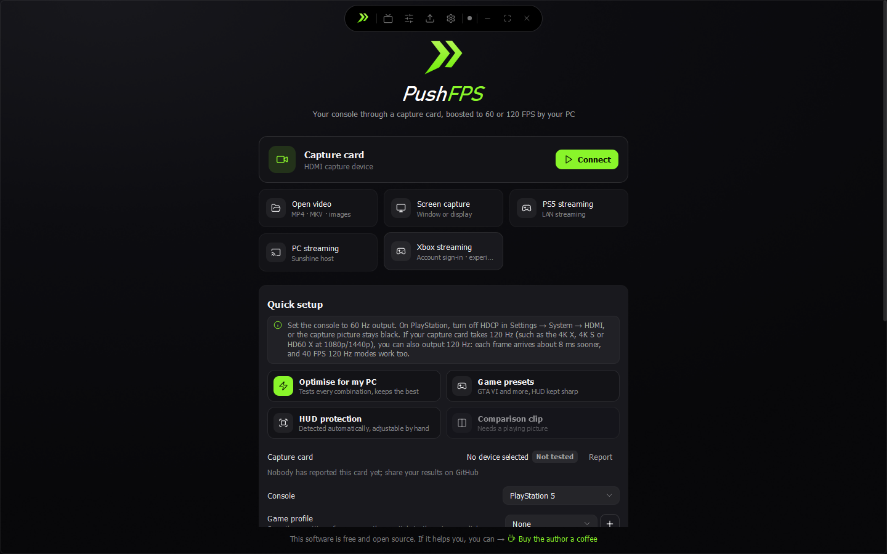

</div>

---

## Why Glide

<table>
<tr>
<td width="33%" valign="top">

**Smoother console games**<br>
A 30 FPS game becomes 60 or 120 FPS, or matches your monitor. Glide finds the real frames inside the
60 Hz signal and generates the ones in between on your GPU.

</td>
<td width="33%" valign="top">

**Set up in a minute**<br>
Pick your console, your game's frame rate and the frame rate you want. Save it as a game profile and
switch back in one click.

</td>
<td width="33%" valign="top">

**Frame generation, with or without AI enhancement**<br>
Generate frames only, or also run every frame through AI picture enhancement for a sharper picture
(NVIDIA RTX cards).

</td>
</tr>
<tr>
<td valign="top">

**Any capture card, any RTX card**<br>
Works with capture cards that Windows sees as a camera, from 1080p60 USB sticks to 4K PCIe cards.
RTX 30, 40 and 50 series; AMD Radeon gets 2× with FSR.

</td>
<td valign="top">

**Streams too**<br>
The OBS Studio plugin puts the Glide picture, generated frames included, straight into your scenes.

</td>
<td valign="top">

**Free and open source**<br>
GPL-3.0, no account needed. Built on Veyra, the open-source video enhancer by Likely7.

</td>
</tr>
</table>

## Only in Glide

Glide is built on [Veyra](https://github.com/Likely7/Veyra-NRVideo), a general video enhancer. On top of
everything Veyra does, Glide adds what console players need:

| Feature | What it does |
|---|---|
| **Optimise for my PC** | Tests every frame generation method your PC has, AI enhancement and the upscalers on your real game picture, measures frame rate, 1% low, latency and jitter, and keeps the best combination for your goal (balanced, lowest latency, smoothest or best picture), up to 144 or 240 Hz |
| **Streaming mode** | An OBS-style page: preview, Glide features, scenes (game scenes with a logo or text, *Starting soon* and *Be right back* cards), go live and record controls, an audio mixer for game sound, microphone and monitor with level meters, and microphone filters (rumble filter, EQ, noise gate, compressor) |
| **Video playback mode** | Frame generation, super resolution, AI enhancement and SDR to HDR on any video on your PC: a browser window with YouTube, a video app, a screen or a file |
| **Lowest latency in one tap** | Every latency setting that costs no picture quality, switched on together; off restores your previous settings |
| **Go live** | Stream the boosted picture straight to Twitch, YouTube, Kick, TikTok, Facebook, Trovo or any RTMP server, to several platforms at once from one encode. Stream keys are stored encrypted |
| **Frame Pacing Repair** | Evens out the uneven frame timing many 30 FPS console games have before frames are generated |
| **Live HUD Lock** | Finds still text, crosshairs and bars on every frame and keeps them sharp in generated frames, no boxes needed |
| **Adaptive multiplier** | Follows the game when its frame rate drops, so the output stays even |
| **Game presets** | GTA VI and other layouts in one click, with the minimap and HUD kept sharp. Save your own and share them as a code |
| **Automatic HUD detection** | Watches your game for a few seconds and finds the minimap, health and ammo, so they are never interpolated. Correct the boxes by dragging them |
| **Before/after comparison clips** | Records a clip with the console's own frame rate on the left and Glide on the right, split screen, side by side or vertical 9:16 for TikTok, Shorts and Reels, 10 to 60 seconds, each side labelled with its frame rate |
| **No capture card needed** | PS5 Remote Play, Moonlight (stream another PC through Sunshine) and Xbox streaming, with the same frame generation, from Veyra |
| **Help on hard settings** | A small **?** beside settings that need explaining; hover it for a short summary |
| **Quick setup** | Console, game frame rate and target frame rate instead of hundreds of settings, with console and game profiles |
| **Latency on screen** | The measured PC latency, frame rate and 1% low over the picture |
| **NVIDIA Image Scaling** | Fast upscaling and sharpening on NVIDIA, AMD and Intel graphics |
| **Picture & sound editor** | Picture styles, gamma, sharpness and sound profiles (bass boost, footsteps, night mode and more) |
| **Share clips** | Saved recordings and instant replays go to Discord in one click |
| **OBS Studio plugin** | Your boosted picture as a source in OBS |
| **Tested capture cards** | Which cards are known to work, shown in the app |
| **14 languages** | English, 简体中文, 繁體中文, 日本語, Nederlands, Deutsch, Español, Français, Italiano, Português (Brasil), Türkçe, Polski, Русский, العربية |
| **Light and black modes** | The default dark grey, an almost-black mode for OLED screens, and a light mode |
| **Plug and play** | Connects to your capture card when Glide opens and goes fullscreen when the picture appears (both optional) |
| **Measure total delay** | A guided slow-motion phone test that shows the whole delay Glide adds over your capture card's passthrough |
| **Linux and macOS (preview)** | Glide's own frame generation, Frame Pacing Repair and Live HUD Lock on Vulkan, OpenGL or Metal, with no vendor components |

## How it works

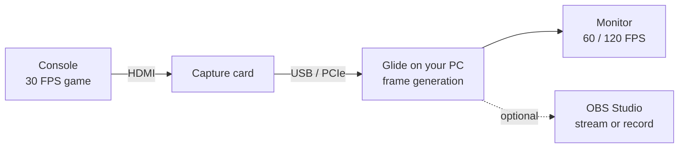

Your console sends its picture to a capture card. Glide reads every frame, notices that a 30 FPS game
repeats each picture twice inside the 60 Hz signal, keeps only the real frames, and fills the gaps with
generated frames on your GPU. You play on the PC monitor.

Generated frames make motion smoother. They don't make the game react faster: the controller still feels
like the original 30 FPS, plus a few milliseconds for the capture card and processing.
[More on latency](#latency).

## Screenshots

<table>
<tr>
<td width="50%">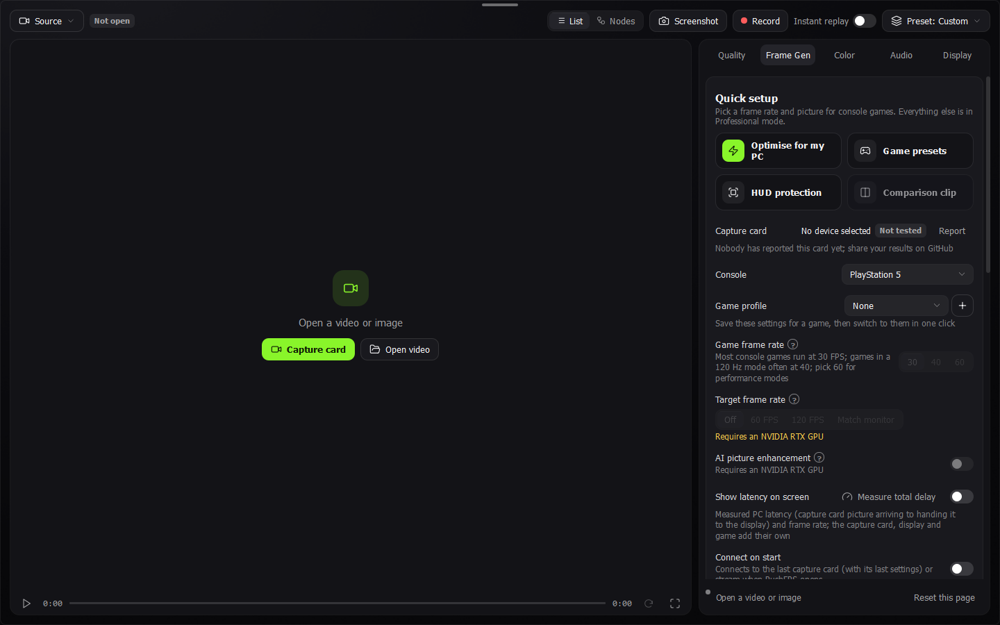<br><sub><b>Frame generation.</b> Quick setup on top, every detail below.</sub></td>
<td width="50%">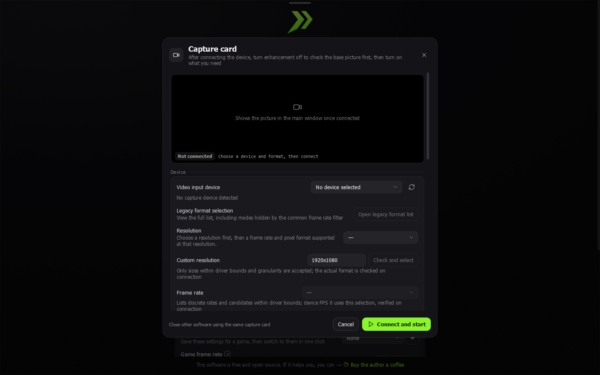<br><sub><b>Capture card.</b> Device, format, frame rate, colour and audio in one dialog.</sub></td>
</tr>
<tr>
<td width="50%">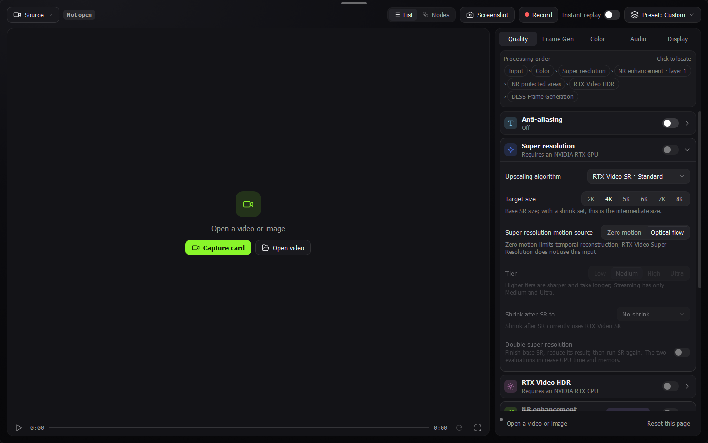<br><sub><b>Picture.</b> Super resolution, AI enhancement layers, HDR.</sub></td>
<td width="50%">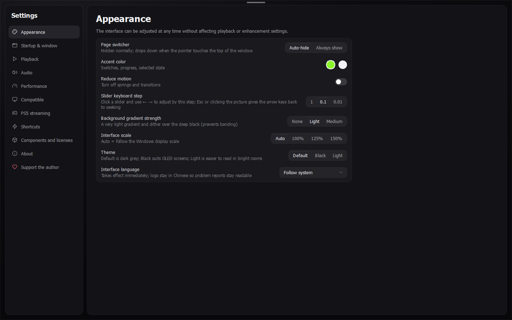<br><sub><b>Settings.</b> Interface, playback, performance, shortcuts.</sub></td>
</tr>
<tr>
<td width="50%">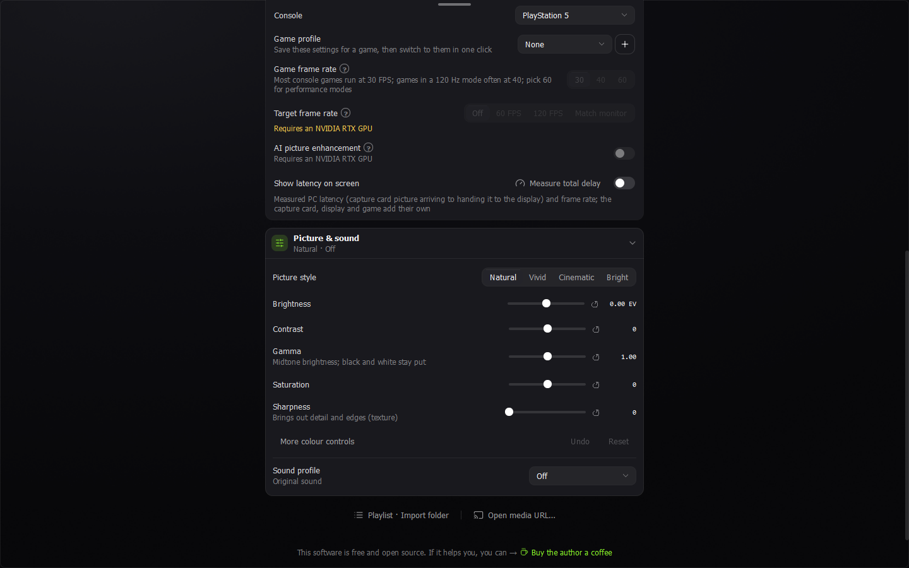<br><sub><b>Picture &amp; sound.</b> Picture styles, gamma, sharpness and sound profiles on the home screen.</sub></td>
<td width="50%">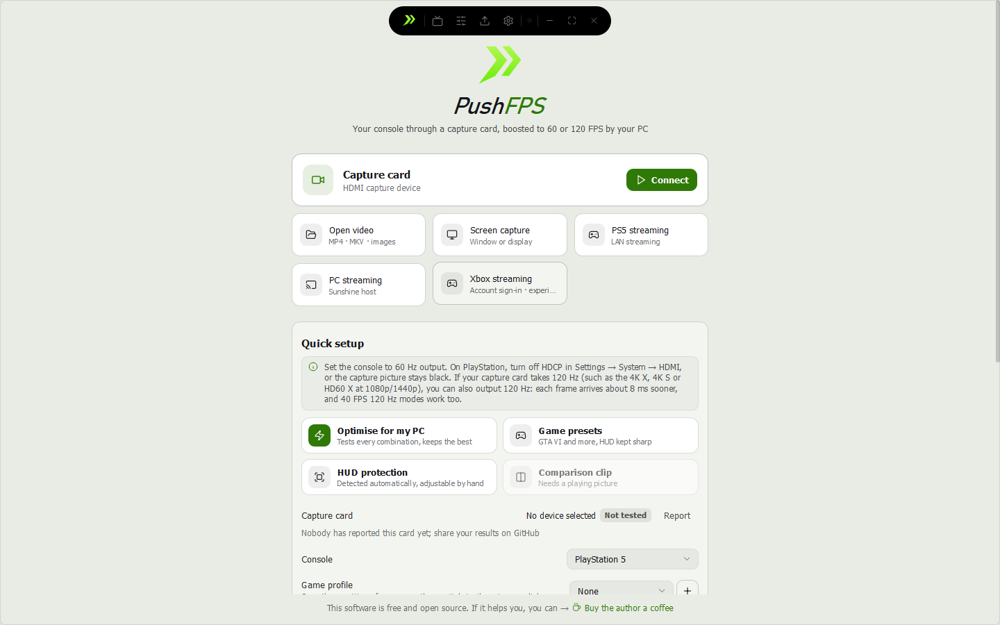<br><sub><b>Light mode.</b> Settings → Appearance.</sub></td>
</tr>
<tr>
<td width="50%">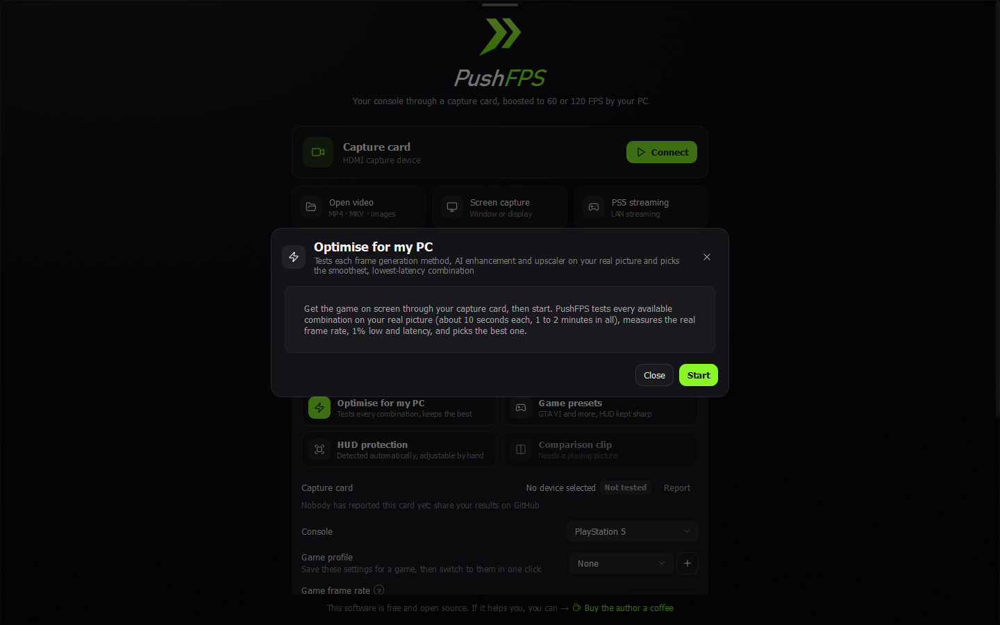<br><sub><b>Optimise for my PC.</b> Tests every combination on your real picture.</sub></td>
<td width="50%">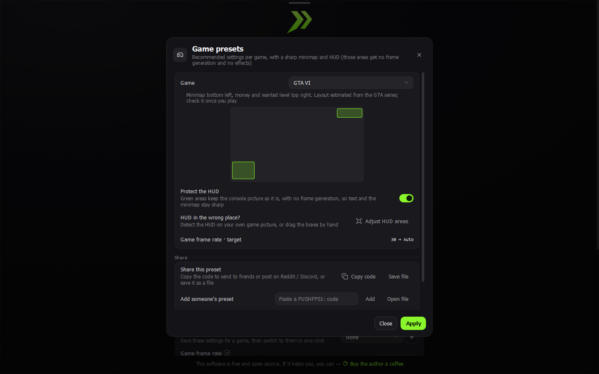<br><sub><b>Game presets.</b> GTA VI and more, with the HUD kept sharp.</sub></td>
</tr>
<tr>
<td width="50%">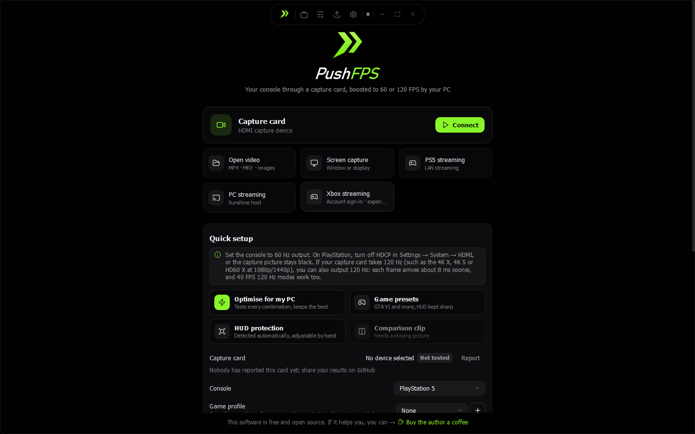<br><sub><b>Black mode.</b> Almost-black surfaces for OLED screens.</sub></td>
<td width="50%">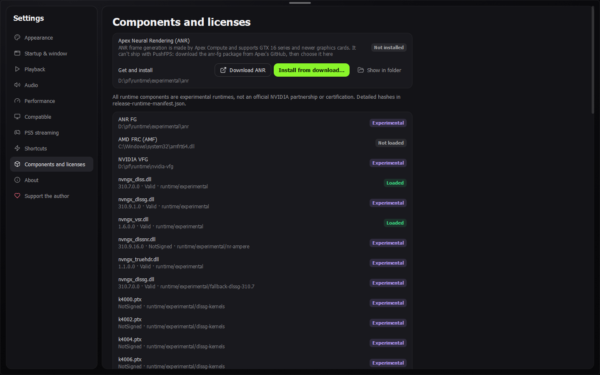<br><sub><b>ANR by Apex Compute.</b> Download from Apex, install in one click.</sub></td>
</tr>
<tr>
<td width="50%">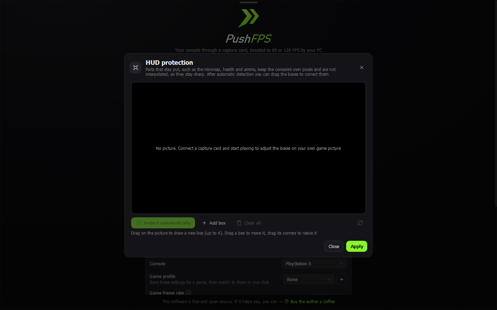<br><sub><b>HUD protection.</b> Automatic detection, boxes you can correct by hand.</sub></td>
<td width="50%">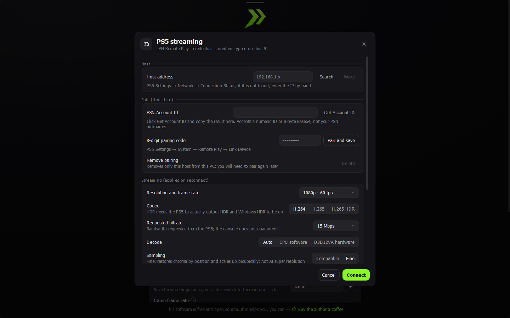<br><sub><b>PS5 streaming.</b> No capture card needed: Remote Play over your home network.</sub></td>
</tr>
<tr>
<td width="50%">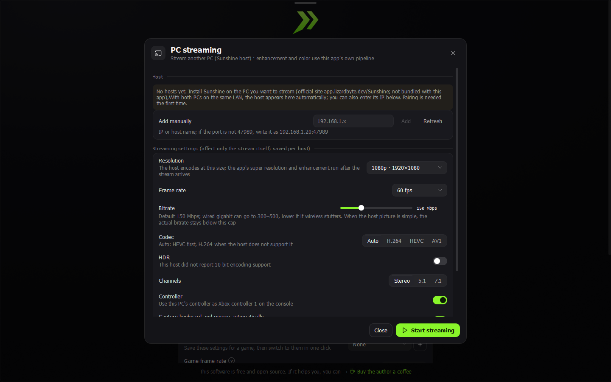<br><sub><b>PC streaming.</b> Another PC through Sunshine (Moonlight protocol).</sub></td>
<td width="50%">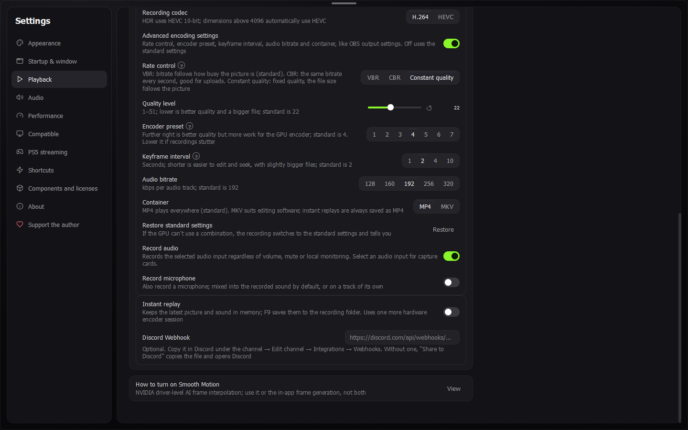<br><sub><b>Advanced encoding.</b> Rate control, quality, preset, keyframes, MP4 or MKV.</sub></td>
</tr>
</table>

<sub>Screenshots of the real app, taken automatically on a build machine without a graphics card, so
NVIDIA-only controls show as unavailable. On an RTX PC they are active.</sub>

## Download and install

1. Download the latest **Glide-…-win64.zip** from [Releases](https://github.com/Omar-Raslan-16006931/Glide/releases)
   and extract it.
2. Double-click **Install-Glide.cmd**.

The installer picks the right package for your graphics card, installs Glide to your user folder (no
administrator rights needed), adds Start menu and desktop shortcuts, and starts it.

<details>
<summary>What the installer does, step by step</summary>

Glide runs on Veyra's official runtime package: Qt, FFmpeg and the NVIDIA, AMD and Intel components
that Veyra's author distributes. The installer downloads that package (about 750 MB) directly from
[Veyra's GitHub release](https://github.com/Likely7/Veyra-NRVideo/releases), checks its SHA-256 against
the value pinned when the Glide release was built, unpacks it, and adds Glide on top. Glide itself
never rehosts those files.

- **Experimental extras.** Veyra's package also has AI enhancement for RTX 30 and Radeon cards, built on
  NVIDIA files used outside the terms NVIDIA licenses them under. The installer asks whether you want them
  (default no); `Install-Glide.cmd -ExperimentalExtras Yes` installs them without asking. Details in
  [NOTICE.md](NOTICE.md).
- Install folder: `%LOCALAPPDATA%\Programs\Glide`
- Update: run the newer installer; your settings and profiles are kept
- Uninstall: `Install-Glide.cmd -Uninstall`, or delete the folder and shortcuts
- Windows may warn about an unknown publisher (Glide isn't code signed yet). Choose *More info*, then
  *Run anyway*, if you downloaded the zip from this repository.

</details>

**Portable install.** Glide keeps its settings, profiles and logs inside its own folder. To keep it out of
your user folder and Start menu, run `Install-Glide.cmd -InstallDir D:\Glide -NoShortcuts` (any folder);
moving or deleting that folder moves or removes Glide. Only the PS5, Moonlight and Xbox sign-ins are kept,
encrypted, in your Windows user profile.

**Checking the download.** Every release lists the SHA-256 of each file in `SHA256SUMS.txt` and the exact
pinned components in `Glide-<version>-components.txt`. In PowerShell: `Get-FileHash Glide-*.zip`.

> [!NOTE]
> Every release is built and start-tested automatically on Windows. Its release notes say plainly which parts
> were also tested by a person with a capture card and GPU. Reports from real setups are very welcome in
> [Issues](https://github.com/DosukaSOL/PushFPS/issues).

## What you need

| | Minimum | Recommended |
|---|---|---|
| **System** | Windows 11 64-bit with DirectX 12 | Latest Windows updates |
| **Graphics card** | NVIDIA RTX 30 series (frame generation is experimental there) | NVIDIA RTX 40 or 50 series |
| **Capture card** | Any card that shows up as a camera in Windows and sends 1080p at 60 FPS without compression, or [stream instead](#no-capture-card-stream-instead) | A card with 4K60 capture and passthrough |
| **Connection** | USB 3 port directly on the PC (no hub) | USB 3.2 Gen 2 or a PCIe card |
| **Console** | Any console with HDMI out | 60 Hz output, or 120 Hz if your capture card captures 120 Hz (passthrough doesn't count) |

AMD Radeon cards can use FSR frame generation (2× only, so 60 FPS from a 30 FPS game). AI picture
enhancement on Radeon and on RTX 30 cards is an optional experimental extra (see below).

<details>
<summary>Which frame generation methods your PC offers</summary>

| Method | Graphics cards | Most frames per real frame |
|---|---|---|
| NVIDIA Video Frame Generation (VFG) | RTX 40, RTX 50 (RTX 30 experimental) | 8× |
| NVIDIA DLSS Frame Generation | RTX 40 (2×), RTX 50 (up to 6×) | 6× |
| Intel XeSS Frame Generation (experimental) | DirectX 12 cards; Veyra tested it on NVIDIA | 4× |
| AMD FSR Frame Generation | DirectX 12 cards (FSR 4 ML preferred on a Radeon RX 9000, falls back to FSR 3.1) | 2× |
| AMD FRC video frame interpolation | AMD graphics with a current AMD driver (uses the driver's AMF runtime) | 2× |
| [ANR Frame Generation](https://github.com/apex-compute/ANR) by Apex Compute (experimental) | GTX 16 and newer, RX 5000 and newer, Intel Arc (Apex's list); install it in *Settings → Components and licenses* | 6× |

</details>

## Get started

1. **Connect everything.** Console HDMI out goes into the capture card's input. The card's USB or PCIe
   connection goes into the PC. If the card has an HDMI passthrough, you can leave a TV on it.
2. **Set the console to 60 Hz.** Even for 30 FPS games, consoles send a 60 Hz signal. 1080p is enough for
   most cards; use 4K if your card captures 4K60.
3. **PlayStation only: turn HDCP off.** Settings, System, HDMI, turn off *Enable HDCP*. With HDCP on, the
   capture card only shows black. Xbox and Switch games are not HDCP protected.
4. **Open Glide and fill in the quick setup** on the home screen, or let Glide do it: connect the capture
   card (step 5), get the game on screen and click **Optimise for my PC**.

   | Setting | What to pick |
   |---|---|
   | **Console** | PlayStation 5, PS5 Pro, Xbox Series X\|S, Nintendo Switch 2 or Other. Each console remembers its own choices |
   | **Game profile** | Optional: save the current settings under a game's name, switch to them later in one click |
   | **Game frame rate** | 30 for most games (GTA VI), 40 for 40 FPS modes, 60 for performance modes |
   | **Target frame rate** | Off, 60 FPS, 120 FPS or Match monitor. Glide picks the frame generation multiplier. 60 on a 60 Hz monitor, 120 on 120 Hz and faster ([target for every refresh rate](https://dosukasol.github.io/Glide/#guide-rates)) |
   | **AI picture enhancement** | Off: frame generation only. On: every frame also goes through AI enhancement on RTX 40/50 cards (RTX 30 and Radeon: experimental extra). Uses a lot more GPU, so start with it off |

5. **Click Connect** on the capture card. Choose your card, its resolution, 60 FPS and the card's audio input.
6. Press **F11** (or Alt+Enter), or double-click the picture, for fullscreen.

> [!TIP]
> Close other apps that use the capture card (OBS, the card's own software) before connecting.

> [!TIP]
> **Setup guide:** the recommended settings to start from, how to tune them, console, capture card and
> Windows settings, and when to use HDR: [on the website](https://dosukasol.github.io/Glide/#guide) or as
> [Glide-Setup-Guide.txt](docs/Glide-Setup-Guide.txt) (also attached to every release).

## No capture card? Stream instead

The home screen also offers three network sources, built on Veyra's streaming support. Frame generation,
AI enhancement, HUD protection, recording and every other Glide feature work on them the same way.

| Source | What it streams | What you need |
|---|---|---|
| **PS5 streaming** | Your own PS5 over your home network (Remote Play protocol, via [chiaki-ng](https://github.com/streetpea/chiaki-ng)) | Remote Play turned on on the PS5, a one-time registration with your PSN account ID and the PIN the PS5 shows. Your controller works through Glide |
| **PC streaming** | Another computer running [Sunshine](https://github.com/LizardByte/Sunshine) (Moonlight protocol) | Sunshine on the other PC and a one-time pairing PIN |
| **Xbox streaming** (experimental, unofficial) | Your own Xbox console over your home network | Remote features turned on on the Xbox and a Microsoft account sign-in |

A wired network (or 5 GHz Wi-Fi) gives the most stable picture. Streams are compressed, so a capture card
still gives the sharpest picture and the lowest latency.
> Only one program can use a capture card at a time. To show Glide in OBS, use the
> [OBS Studio plugin](#obs-studio-plugin) instead.

## Optimise for my PC

Click **Optimise for my PC** in the quick setup while your game is on screen, and pick a goal: **Balanced**,
**Lowest latency**, **Smoothest** or **Best picture**. In one to three minutes Glide:

1. measures the picture without effects, to find the game's frame rate (30, 40 or 60) and the base latency;
2. tries every frame generation method your PC can run (DLSS, NVIDIA VFG, ANR, FSR 4/3.1, XeSS, AMD FRC) at
   the highest frame rate your screen shows: your monitor's own rate on 144, 165 or 240 Hz screens when the game
   divides into it evenly, otherwise 120 FPS, and 60 FPS if none holds that;
3. adds AI enhancement to the best one, then the upscalers when your screen is larger than the capture;
4. measures the winner again to confirm it, and applies it. **Undo** puts your old settings back.

The result lists every method it skipped and why (not supported by this graphics card, not installed), and
shows PC processing latency, its 95th percentile and frame-time jitter for each tested combination.

Every number is measured on the real picture: Glide times each frame it hands to the display and each
frame's latency, after the settings are applied and warmed up, over a 6-second window per combination. A
combination only counts when it really generated frames, reached 95 % of its target, kept its 1% low at
80 % of the target, dropped under 1 % of the capture card's frames, and added no more than 60 ms of latency.

## Game presets

Click **Game presets** in the quick setup and pick a game:

| Preset | Protected areas |
|---|---|
| **GTA VI** | Minimap bottom left; money and wanted level top right (estimated from the GTA series, check it once you play) |
| Open world, minimap bottom left / top right | The minimap |
| Action, HUD in the bottom corners | Health, weapon and ammo |
| Racing, speedometer bottom right | Speed, gear and minimap |
| Shooter, HUD in all four corners | Every corner |
| Cinematic | None |

Protected areas use *Exclude all effects*: they keep the console's own pixels and are never interpolated, so
text and the minimap don't smear when the camera moves. **Adjust HUD areas** opens the HUD editor (see below);
Professional mode, *Quality*, *Exclude all effects* has the same areas. **Save current settings as a preset** stores your own, including the areas you drew.
**Copy code** gives a `PUSHFPS1:` code to share on Reddit or Discord; **Add** or **Open file** imports one.

### Nintendo Switch and Switch 2

Many Switch games stay at 30 FPS even on Switch 2 when they have no Switch 2 update, and several Switch 2 ports
run at 30 FPS docked. The presets list has a filter for each console (it starts on the console you picked in the
quick setup) and sets the console, the game's frame rate and the target in one click:

- **Switch:** Hyrule Warriors: Age of Calamity, Pokémon Legends: Arceus, Zelda: Breath of the Wild (the original;
  the Nintendo Switch 2 Edition runs at 60), Xenoblade Chronicles X: DE, Monster Hunter Rise, The Witcher 3,
  DOOM Eternal, Batman: Arkham Knight, Kingdom Come: Deliverance, Shin Megami Tensei V: Vengeance,
  Mario + Rabbids Sparks of Hope, Animal Crossing: New Horizons, Fire Emblem: Three Houses, Fire Emblem Engage,
  Persona 5 Royal, Pokémon: Let's Go, Dragon Quest XI S, Astral Chain.
- **Switch 2:** Cyberpunk 2077, Hogwarts Legacy, Final Fantasy VII Remake and Rebirth, Star Wars Outlaws,
  Assassin's Creed Shadows, Elden Ring, Indiana Jones and the Great Circle, Persona 3 Reload, Lies of P.

Frame rates come from public tests (Digital Foundry, the howsitrun.com database and Switch 2
backward-compatibility reports). Games whose frame rate dips (Age of Calamity, Arkham Knight, Cyberpunk 2077,
Star Wars Outlaws, Elden Ring) turn on the adaptive multiplier. HUD areas are set only where the layout is well
known (Breath of the Wild, The Witcher 3, DOOM Eternal, Cyberpunk 2077, Elden Ring, Lies of P); for the others
use **Adjust HUD areas** to find them automatically. Set the Switch to its dock, 60 Hz; games have no HDCP.

## Adaptive multiplier

Console games rarely hold one frame rate: a 30 FPS game dips to 25, a 40 FPS mode wanders between 35 and 45,
Elden Ring on Switch 2 sits anywhere from 30 to 40. With a fixed multiplier the output follows every dip. Turn
on **Adaptive multiplier** in the quick setup (or under frame generation in Professional mode) and the
multiplier becomes a ceiling: Glide measures the game's frame rate from the capture card picture (automatic
duplicate removal) and, for every pair of real frames, uses the multiplier whose output lands closest to the
target (your output cap, or the monitor's refresh rate).

At a 120 FPS target: 30 FPS → 4X, 40 FPS → 3X, 36 FPS → 3X (108), 33 FPS → 4X (132), 25 FPS → 5X with ANR or
VFG, 4X with DLSS (which has no 5X). A change waits half a second so a game sitting on a boundary doesn't make
it flicker. The quick setup shows what it is doing ("Now 3×: game 38 FPS → about 114 FPS").

This is the same idea as NVIDIA's DLSS 4.5 Dynamic Multi Frame Generation, which switches between whole
multipliers to reach the display's refresh rate; Glide bases it on the console's frame rate and it works
with DLSS, ANR and NVIDIA VFG frame generation. FSR, AMD FRC and XeSS generate a fixed 2X or pace themselves,
so the switch is not offered for them. A lower multiplier also means a little less delay.

## Frame Pacing Repair

Many console games locked to 30 FPS don't deliver their frames evenly. Instead of every frame staying on screen
for two 60 Hz refreshes, some stay for one and others for three (17 ms, then 50 ms). The game simulated them 33 ms
apart, so the motion judders even though the frame rate is right, and frame generation keeps that judder. The
console can't fix it: the picture it sends is already uneven.

**Frame Pacing Repair** (quick setup, or frame generation in Professional mode) puts every real frame back on an
even grid before frames are generated. It fits a line through the arrival times of the last frames, so a 17/50 ms
game becomes 33/33. It only acts on what it can explain as uneven delivery of a locked frame rate. A stall
restarts it, and a game whose frame rate genuinely varies keeps its own timing. A frame is shown at most one
capture refresh later; for the common 17/50 ms pattern about half a refresh. The quick setup shows how much of the
picture it is re-timing. It needs automatic duplicate removal, which it turns on.

## Live HUD Lock

Frame generation interpolates every pixel between two real frames, so still text, crosshairs and health bars get
dragged along with the moving background and smear or wobble. HUD protection fixes this with boxes. **Live HUD
Lock** finds those pixels itself, on every frame, on the graphics card. A pixel that has stayed the same for
about a second and has an edge (text, a crosshair, a bar) is taken from the real frame in the generated frames,
and released the moment it moves. A still pixel looks the same in the real frame, so locking one that isn't HUD
(a still wall) changes nothing visible. Works with DLSS, ANR, NVIDIA VFG, FSR and AMD FRC frame generation; XeSS
generates inside its own presenter, so it can't be combined.

## Automatic HUD detection

Click **HUD protection** in the quick setup while your game is playing, then **Detect automatically** and
turn the camera or walk around for about five seconds. Glide looks for the parts of the picture that keep
their detail while everything else moves (minimap, health, ammo, prompts) and draws up to four green boxes
around them on a frame of your own game.

If a box is off, fix it by hand: drag a box to move it, drag its corners to resize it, drag on an empty spot
to draw a new one, and use the **×** on the selected box to delete it. **Apply** protects the boxes: those
areas keep the console's own pixels and are never interpolated. With no boxes, the whole picture is
interpolated.

If the picture hardly moved during detection (a menu, a paused game), Glide can't tell the HUD apart and
asks you to try again while moving. The detection reads a few presented frames on the GPU and works with
every frame generation method; it does not change any setting until you click **Apply**.

## Smooth frame pacing

**Smooth frame pacing** in the quick setup (on by default) makes live play look like a recording:
- every frame is shown at a screen refresh (V-Sync);
- variable refresh (G-SYNC/FreeSync) is requested where your screen has it;
- the output is capped at your refresh rate.

Every generated frame is shown once. With variable refresh it adds almost no delay; without it a frame can wait up to one refresh. Turn it off for the lowest-latency mode, where a frame can now and then be skipped. For the best result, turn on G-SYNC/FreeSync in your graphics driver and play in fullscreen (F11).

## Lowest latency (one tap)

**Lowest latency** in the quick setup turns on every latency setting that costs no picture quality:
- the graphics card queues only one frame (NVIDIA Low Latency on NVIDIA cards, the low queue on others);
- fullscreen when the capture card or stream connects, which skips the desktop compositor's extra refresh;
- on a G-SYNC/FreeSync screen, smooth frame pacing with variable refresh (no tearing, no skipped frames).

Frame generation, AI enhancement, HUD lock and pacing repair stay as they are. On a screen without variable
refresh the display sync is left alone, so the picture never tears. Turning it off brings back your previous
settings. The row shows the measured processing latency, and suggests 120 Hz console output where it would
save about 8 ms per frame.

## Before/after comparison clips

**Comparison clip** in the quick setup opens a small dialog: pick the layout and the length (10, 15, 30 or 60
seconds), then **Start recording** (the same two choices are under *Settings, Playback*). The clip goes into your recordings folder (`Glide-compare-….mp4`).

- **Split**: one picture cut down the middle. The left half is the raw console picture, each real frame held
  until the next one arrives, so it moves at the game's own frame rate; the right half is every frame Glide
  shows, with frame generation and AI picture enhancement.
- **Side by side**: the whole picture twice, each at half size: the raw console picture on the left, Glide
  on the right, on a black background.
- **Vertical (TikTok, Shorts, Reels)**: a 1080×1920 video, the console on top and Glide below, each filling
  half the screen with the middle of the picture. The badges sit next to the divider, where those apps leave the
  screen free. H.264, ready to upload from your phone (HDR recordings stay HEVC 10-bit).

The console side has no AI enhancement, upscaling or colour changes, so the clip shows exactly what Glide adds.
Each side has a badge at the top: *Console · 30 FPS* and the Glide logo with its frame rate, in SDR and HDR. Frame generation has to be on, using any method except XeSS (XeSS makes its frames as they
are shown, after the recorder has read the picture). Click the tile again to stop early. The card that appears
afterwards can share the clip to Discord.

## Profiles

**Console profiles.** Switching the console in the quick setup keeps what you set for the previous console
and brings back what you set for the new one: game frame rate, target frame rate, AI enhancement and
NVIDIA Low Latency. The setup tip on the home screen follows the console too.

**Game profiles.** Click **+** next to *Game profile*, type a name (for example *GTA VI*) and confirm. The
profile stores the console, game frame rate, target, AI enhancement and low latency. If the Professional
settings currently match a saved preset, the profile remembers that preset as well and applies it first, so
a game profile can carry every detail. Pick the game from the list to switch; the bin removes it.

## Picture and sound

Open **Picture & sound** on the home screen to adjust the picture and sound before you play or record:

| Control | What it does |
|---|---|
| **Presets** | *Natural*, *Vivid*, *Cinematic* or *Bright* as a starting point |
| **Brightness, contrast, gamma, saturation, sharpness** | Fine-tune the look. *Reset* goes back to the original picture, *Undo* takes back the last change |
| **More colour controls** | Opens the full colour editor in Professional mode: curves, colour wheels, LUTs, saved looks |
| **Sound profile** | *Bass boost*, *Voice clarity*, *Footsteps*, *Night mode* (quiet sounds louder, loud sounds softer), *Cinema*, or your own 5-band equaliser |

Everything you set here is part of the picture and sound you see, hear and record. Sound profiles are
also in Professional mode under *Audio*. Dolby and DTS passthrough to a receiver are not changed.

**After recording.** When a recording or an instant replay clip is saved, a card offers **Edit** (opens it in
the editor), **Export** (trim, pick tracks, re-encode) and **Show in folder**.

## Recording, instant replay and microphone

- **Record** (F8) saves what you see and hear, with the picture, sound profile and frame generation applied.
- **Instant replay** keeps the last minute (15 seconds to 10 minutes) in memory; press **F9** to save it.
  Turn it on next to the Record button or under *Settings, Playback*. It can run while you record. It uses
  an extra hardware encoder and some memory while it is on, so it is off by default.
- **Microphone**: add your mic to recordings, mixed with the game sound or as its own audio track.
- **Share to Discord**: the card that appears after saving has **Share to Discord**. Without setup it copies
  the clip and opens Discord, so you paste it with Ctrl+V. With a Discord webhook in *Settings, Playback*
  it posts clips up to 10 MB straight to that channel.
- **Advanced encoding settings** (*Settings, Playback*, off by default): rate control (VBR, CBR or constant
  quality with a 1–51 level), encoder preset 1–7, keyframe interval, audio bitrate and MP4 or MKV, like OBS's
  output settings. Off, recordings use the standard settings. If the graphics card can't use a combination,
  the recording falls back to the standard settings and says so.
- **Standard settings**: about 37 Mbps for 1080p at 60 FPS, 66 Mbps at 1440p and 150 Mbps at 4K (H.264,
  less with HEVC), with room for fast motion. Pick a fixed bitrate under *Settings, Playback* for smaller files.
- **Works in video editors**: a finished MP4 recording is rewritten as a standard MP4 (no re-encoding), so it
  opens in Vegas Pro, Premiere Pro, DaVinci Resolve and others. While recording it is kept in a crash-safe
  format, so a crash or power cut still keeps what was recorded.

## Streaming mode

**Streaming mode** (the broadcast button in the top bar) is a page laid out like OBS Studio, with Glide's own
features built in:
- **Preview** in the middle, with the source, the game's frame rate and what Glide shows.
- **Glide features** on the left: frame generation, adaptive multiplier, pacing repair, HUD lock, AI
  enhancement and lowest latency, as in the quick setup.
- **Controls** on the right: go live, record, save the instant replay, comparison clip, screenshot, your
  streaming platforms and each platform's state and bitrate while live.
- **Audio mixer** across the bottom, like OBS's: *Game sound* and *Microphone* faders with level meters and
  mute, for what recordings and streams take, and *Monitor* (what you hear yourself). Choose whether the
  microphone goes into recordings, streams or both.
- **Scenes**, like OBS's, switched with one click or **Ctrl+1** to **Ctrl+9**:
  - *game scenes* show the picture, optionally with a corner picture (your logo) or a text tag;
  - *card scenes* (*Starting soon*, *Be right back*, *Thanks for watching*, or your own with a background
    picture) replace the game in recordings and streams and mute the game sound.
  Scenes change only what recordings and streams show; you keep seeing the game.
- **Microphone filters** (the sliders button on the microphone): rumble filter, 5-band equaliser with voice
  presets, noise gate and compressor, then a -1 dB limiter that is always on.
- **Status bar**: live time, bitrate and dropped frames, recording time, processing latency and the encoder.

## Video playback mode

**Video playback mode** (the play button in the top bar) puts Glide's tools on any video on your PC:
- pick a **window** (a browser playing YouTube, a video app), a **whole screen** or a **video file**;
- switch on **Smoother** (frame generation: 24 or 30 FPS video looks like 60 or 120 FPS), **Sharper**
  (super resolution to your screen), **AI picture enhancement** (removes compression blocks and noise) and
  **SDR to HDR** (on an HDR monitor with Windows HDR on);
- press F11 to watch fullscreen.

If a browser window captures black, turn off hardware acceleration in the browser's settings; copy-protected
streams may stay black.

## Go live: Twitch, YouTube, Kick and TikTok

Click **Go live** in the quick setup to stream the picture you see, frame generation, picture settings and sound
included, straight from Glide. No OBS needed.

- **Several platforms at once.** Add up to eight outputs (Twitch, YouTube, Kick, TikTok, Facebook Live, Trovo or
  any RTMP/RTMPS server) and switch on the ones you want. One encode feeds them all, so streaming to three
  platforms costs no more graphics card time than one; each platform gets its own upload.
- **OBS's settings.** Server lists and recommended limits come from OBS Studio's service list. The bitrate
  follows the strictest platform you stream to (Twitch 6 Mbps, Kick 8 Mbps), at 30 or 60 FPS, H.264 with
  constant bitrate and a keyframe every 2 seconds, as the platforms ask.
- **Stream keys stay private.** A key is encrypted for your Windows user (DPAPI), never shown again, never
  written to logs, and only sent to the server it belongs to.
- **Keeps going.** Each output reconnects by itself when the connection drops; the others keep streaming. The
  dialog shows each output's state, bitrate, dropped frames and reconnects.
- Game sound and your microphone (mixed in). Recording and instant replay can run while you are live; each uses
  its own encoder session.

TikTok gives a server address and key only to accounts with LIVE access (TikTok LIVE Producer). Streaming needs
an SDR picture: turn HDR output off first.

## Upscaling: NVIDIA Image Scaling and more

Professional mode, *Quality*, *Super resolution*, *Upscaling algorithm* offers DLSS SR, RTX Video Super Resolution (three model
families), AMD FSR 3.1 and **NVIDIA Image Scaling (NIS)**. NIS is a fast spatial upscaler with adaptive
sharpening that runs on NVIDIA, AMD and Intel graphics. Set the strength with *NIS sharpening* (50 % is
NVIDIA's default; 0 % only upscales). NIS enlarges up to 2x in one pass, so a 1080p capture fills a 4K
screen directly; larger factors are finished with regular scaling. It works in SDR and HDR.

**Keep the HUD sharp.** *Exclude all effects* regions (up to four rectangles or ellipses, from Veyra 2.1.6)
leave parts of the picture, such as the minimap or the HUD, untouched by every effect and by frame
generation.

## OBS Studio plugin

The plugin adds a **Glide** source to OBS Studio 28 or newer on Windows, including OBS 33 (it installs in
the plugin layout that OBS 34 will require, so the Plugin Manager doesn't flag it as Legacy). It shows the Glide picture,
generated frames included, in any scene, and can start Glide for you.

1. Download **Glide-OBS-Plugin-…-win64.zip** from [Releases](https://github.com/Omar-Raslan-16006931/Glide/releases)
   and extract it.
2. Close OBS Studio and double-click **Install-Glide-OBS.cmd** (no administrator rights needed).
3. Start OBS Studio. Under *Sources*, click **+** and pick **Glide**.

| In the source's properties | What it does |
|---|---|
| **Open Glide** | Starts Glide with OBS game capture support, or brings it to the front (also under *Tools*) |
| **Capture method** | *Game capture* receives every generated frame (recommended). *Window capture* is the fallback |
| **Start Glide when this source is shown** | On by default |
| **Glide.exe location** | Only needed if Glide isn't in its default folder |

For sound, add an *Application Audio Capture* source and pick `Glide.exe`. If you start Glide yourself
instead of from OBS, turn on *Settings, Compatible, OBS Game Capture compatibility* in Glide once and
restart it. Uninstall: `Install-Glide-OBS.cmd -Uninstall`.

<sub>How it works: Glide keeps doing the processing on your GPU; the plugin drives OBS's own game capture
(or window capture) pointed at the Glide window. Every build is loaded into the latest OBS Studio on
GitHub Actions, which opens a scene with a Glide source, lets it start Glide and checks that it finds
the window.</sub>

## Capture cards

| Capture card | Status |
|---|---|
| Elgato 4K X | Tested with Glide (RTX 5090, console games and videos) |
| T911 4K60 | Tested by Veyra's developer (4K60 NV12, RTX 5070) |
| Elgato HD60 X | Tested with Glide |
| Elgato 4K S | Tested with Glide |
| Elgato 4K Pro / 4K60 Pro | Not tested yet |
| AVerMedia Live Gamer 4K 2.1 (GC575), Live Gamer Ultra 2.1 (GC553G2) | Not tested yet |
| Magewell USB Capture HDMI 4K Plus | Not tested yet (native low-latency mode from Veyra) |
| Blackmagic DeckLink / UltraStudio | Not tested yet (Blackmagic's own interface from Veyra) |

Any card that Windows shows as a camera and that sends uncompressed 1080p60 or 4K60 should work. The quick
setup shows whether your card is on this list.

Capture at 60 FPS, even for 30 FPS games (Glide removes the repeated pictures), in uncompressed NV12 or
P010 rather than MJPEG. Delay measured by Veyra's developer: about 10-20 ms at 1440p60 NV12, 30-40 ms at
4K60 NV12 (10 Gbps or PCIe cards) and 80-100 ms at 4K30 HDR. For the lowest delay, capture 1440p60 and let
RTX Video Super Resolution upscale it. Which card to buy (5 Gbps, 10 Gbps, PCIe) is in the
[setup guide](https://dosukasol.github.io/Glide/#guide-capture). Tested yours?
[Send a capture card report](https://github.com/DosukaSOL/PushFPS/issues/new?template=capture-card-report.yml).

## Languages and appearance

**Settings → Language** has 14 languages: English, Simplified and Traditional Chinese, Japanese, Dutch,
German, Spanish, French, Italian, Portuguese (Brazil), Turkish, Polish, Russian and Arabic. *Automatic*
follows your Windows language.

In the ten newest (Dutch to Arabic) every button, menu and setting name and all Glide feature texts are
translated by hand; longer help texts in the advanced pages are machine-translated with
[Argos Translate](https://github.com/argosopentech/argos-translate) and fall back to English where the
machine output was not usable. If a word reads wrong in your language, please open an issue, or fix it in
`scripts/i18n/hand/<language>.txt`. Arabic text is shown correctly, but the layout is not fully mirrored
right-to-left yet.

**Settings → Appearance** switches between *Default* (dark grey), *Black* (almost-black surfaces, good on
OLED screens) and *Light*. Text and controls keep a readable contrast in every mode (checked by an
automated test); the picture itself is never changed.

**Sunset City.** Glide opens with a three-second intro: a neon road out of the dark, the logo landing on the
beat, the sky turning to sunset over a palm-lined city, and the logo gliding into place on the home page, where
it stays filled with the sunset city. The music is the startup track that comes with Veyra's runtime package.
Click or press any key to skip; *Settings → Appearance* has separate switches for the Sunset City logo, the
intro and the music. All of the art is drawn by Glide itself (`scripts/brand/make_sunset.py`).

## ANR frame generation by Apex Compute

[Apex Neural Rendering (ANR)](https://github.com/apex-compute/ANR) is frame generation made by
[Apex Compute](https://apexcompute.com). Apex lists support for GeForce GTX 16 and newer, Radeon RX 5000 and
newer and Intel Arc, so it is an option on graphics cards that DLSS Frame Generation does not cover. Glide
runs it on your capture card picture, the same way Veyra 2.1.6 does.

ANR is in beta and Apex does not allow it to be redistributed, so it is not inside Glide. To use it:

1. Download the `anr-fg-addon` package (or `anr-fg-full`) from [ANR's releases](https://github.com/apex-compute/ANR/releases).
2. In Glide open *Settings → Components and licenses* and click *Install from download…*, then choose the
   `.zip` you downloaded. Glide copies ANR's files into its own folder on your PC; nothing is sent anywhere.
3. Restart Glide and pick *ANR FG* as the frame generation method in Professional mode.

ANR in games gets motion data from the game itself. From a capture card Glide has only the picture, so the
motion is estimated, as with every method in Glide: results can differ from what ANR shows in games.

## Linux and macOS (preview)

Glide for Linux and macOS is a separate, smaller app (`portable/` in this repository) with Glide's own frame
generation: block motion estimation on the processor and motion-compensated interpolation on the graphics card
(Vulkan or OpenGL on Linux, Metal on macOS), plus Frame Pacing Repair, duplicate-frame removal and Live HUD Lock.
It needs no NVIDIA, AMD or Intel components, so it runs on any graphics card that supports OpenGL 3.3, Vulkan or
Metal.

| | Linux | macOS |
|---|---|---|
| Download | `Glide-<version>-linux-x86_64.AppImage` or `.tar.gz` | `Glide-<version>-macos-universal.zip` (Apple Silicon and Intel) |
| Needs | x86-64, glibc 2.31+ (Ubuntu 20.04+, Debian 11+, Fedora 33+), X11 or Wayland, OpenGL (`libopengl0`, present on desktop systems) | macOS 12 or newer |
| Capture cards | Any UVC card (`/dev/video*`): almost every USB card | Any card macOS lists as a camera |
| Portable | Put an empty `portable.txt` next to the program | Put an empty `portable.txt` next to Glide.app |

Try it without a capture card: **Home → Test picture**. `Glide --selftest 6` checks the whole chain.

Not in the preview yet: the NVIDIA/AMD/Intel frame generation and AI enhancement (Windows only), recording,
going live and the streaming sources. It is tested automatically (core tests with sanitizers, self-tests, a GPU
check against the processor reference, a clean Ubuntu container); it is not code signed or notarised, so macOS
asks you to confirm the first start (right-click → Open).

## Tune it for your setup

| If you see | Try |
|---|---|
| Black picture from a PlayStation | Turn HDCP off on the console |
| Stutter every second or so | Set the capture card to exactly 60 FPS, close other apps that use the card, use a USB port directly on the PC |
| Smeared HUD or text during fast motion | Pick a lower target (60 instead of 120), or a higher frame generation quality in Professional mode |
| Picture looks washed out | Match the colour settings in the capture dialog to the console: HDR (PQ) or SDR, Limited or Full range |
| The game feels slow to react | Turn on NVIDIA Low Latency. Frame generation can't reduce the game's own delay |
| Frame rate drops with AI enhancement on | Turn AI enhancement off, or lower its resolution in Professional mode |

## Latency

Turn on **Show latency on screen** in the quick setup to see the measured PC latency (capture card picture
arriving to handing it to the display, mean and 95th percentile), the frame rate and the 1% low over the
picture. The capture card, the display and the game add their own delay, which software can't measure.

To place a frame between two real frames, Glide has to wait for the second one. With a 30 FPS game that
adds up to one frame (about 33 ms) on top of the capture card's own delay, which depends on the card.
Generated frames make motion look like 120 FPS, but your inputs still take effect at the game's own pace.

For fast competitive games, use **Off** and play on the console's own display path.

Ways to lower it:

- **120 Hz output.** If your capture card captures 120 Hz (for example the Elgato 4K X, or the 4K S at 1080p or
  1440p), set the console to 120 Hz: each frame reaches the PC about 8 ms sooner, and 40 FPS games in a 120 Hz
  mode work too (pick 40 as the game frame rate). Passthrough doesn't count: a card that only passes 120 Hz
  through to your TV (such as the HD60 X, which captures 60 Hz) needs a 60 Hz console output. This is the same
  on every console, PS5 Pro included.
- **NVIDIA low latency** in the quick setup on NVIDIA graphics.
- **One graphics card for everything.** With two graphics cards, connect the monitor to the one Glide
  processes on; Glide warns when every frame has to be copied between cards.

To see the whole delay, not just Glide's part, use **Measure total delay** next to the latency switch: film
the capture card's passthrough screen and Glide side by side in slow motion and count the frames between them.

## FAQ

**Does it work with games that already run at 60 FPS?**
Yes. Set *Game frame rate* to 60 and pick 120 FPS or Match monitor: a 60 FPS game gets one generated frame
in between (two on a 240 Hz monitor).

**Does it change the console or the game?**
No. Glide only processes the video coming out of the capture card. Nothing is installed on the console.

**Is it free?**
Yes. Glide is free and open source under the GPL-3.0, like Veyra.

**Is there a macOS or Linux version?**
Yes, as a preview: see [Linux and macOS (preview)](#linux-and-macos-preview). It has Glide's own frame
generation instead of the NVIDIA, AMD and Intel methods, which only exist for Windows.

**Where are my settings and profiles stored?**
In your user folder, next to Veyra's settings. Updating Glide keeps them.

## Roadmap

- [x] Glide name, logo and update channel
- [x] Quick setup: target frame rate, frame generation with or without AI enhancement
- [x] Windows release with automated, reproducible builds
- [x] Per-console and per-game profiles
- [x] OBS Studio plugin
- [x] Cleaner interface: capture card first, less text, aligned controls
- [x] Picture and sound editor, sound profiles, edit after recording
- [x] NVIDIA Image Scaling (NIS) upscaling and sharpening on any DirectX 12 GPU
- [x] Instant replay and microphone recording (from Veyra 2.1.6)
- [x] Optimise for my PC: measured, automatic settings
- [x] Game presets with HUD protection and share codes
- [x] Latency readout on the picture
- [x] Share clips to Discord
- [x] Capture card list with tested status and a report form
- [x] 14 interface languages, light and black appearance modes
- [x] Automatic HUD detection with a box editor
- [x] Before/after comparison clips
- [x] Help marks (**?**) on settings that need explaining
- [ ] Native-speaker review of the machine translations, right-to-left layout for Arabic
- [ ] More tested capture cards and game presets, from player reports
- [x] PS5 Remote Play, Moonlight and Xbox streaming in the release builds
- [x] Veyra 2.1.9: AMD FRC frame generation, FSR 4 ML with FSR 3.1 fallback, local audio monitoring separate from recording, NVIDIA G-SYNC profile check and repair, processing on a second graphics card
- [x] Plug and play (connect on start, fullscreen on connect), 120 Hz and 40 FPS guidance, total-delay guide, always on top
- [x] Go live to Twitch, YouTube, Kick, TikTok and more, several platforms at once
- [x] Optimiser goals, every frame generation method tested, 144-240 Hz targets
- [x] Linux and macOS preview with Glide's own frame generation
- [ ] Linux and macOS: tested capture cards, recording and going live
- [ ] Code signing (SignPath Foundation application)

## Privacy

Glide has no accounts, analytics or telemetry. It only connects to the internet for the update check (GitHub),
when you share a clip to your own Discord webhook, when you connect a streaming source, and when you go live
(only to the platforms you chose). Details in [PRIVACY.md](PRIVACY.md).

## Build from source

Every push builds Glide on GitHub Actions ([build-windows.yml](.github/workflows/build-windows.yml)), and
that workflow is the build recipe: Visual Studio 2022, CMake with Ninja, Qt 6.8.3, FFmpeg 9.0.1 from vcpkg
at the pinned baseline, the NVIDIA DLSS SDK 310.7.0, nv-codec-headers, the CUDA driver header, Intel XeSS
3.0.2 and AMD FidelityFX 1.1.4 and 2.3.0. All of them are downloaded from their official public sources at
pinned versions; none is committed. The workflow then runs the unit and interface tests, checks that
`Glide.exe` links exactly the Qt and FFmpeg libraries in Veyra's runtime package, installs it with the real
installer and opens every main page, failing on any interface error.

The NVIDIA Optical Flow SDK needs a developer login, so its headers are never in this repository. Release
builds get its two interface headers from a private repository secret (`NVOF_SDK_HEADERS`) and then include
NVIDIA optical flow as Veyra does; a build without the secret (a fork, for example) uses AMD FidelityFX
optical flow for motion estimation instead (it runs on any DirectX 12 GPU). NVIDIA Video Frame Generation
has its own optical flow and is not affected. If you build locally with the Optical Flow SDK in
`third_party_local/nvidia/Optical_Flow_SDK_5.0.7`, NVIDIA optical flow is available as in Veyra.

The OBS plugin ([obs-plugin/](obs-plugin)) is a small C module built against OBS's public headers:

```
cmake -S obs-plugin -B build-obs -A x64 -DOBS_SOURCE_DIR=<obs-studio checkout>
cmake --build build-obs --config Release
```

More background: [docs/DEVELOPMENT.md](docs/DEVELOPMENT.md), [THIRD_PARTY_NOTICES.md](THIRD_PARTY_NOTICES.md).
Inside the code, Glide keeps Veyra's names (namespaces, targets, the `qml/Veyra` module) so fixes from
Veyra keep merging cleanly. The Glide name and links live in
[`include/veyra/Brand.h`](include/veyra/Brand.h).

## Credits and license

Glide is a modified version of **[Veyra](https://github.com/Likely7/Veyra-NRVideo)** by
**[Likely7](https://github.com/Likely7)**, forked on 2026-11-12. Nearly all of the engine, the capture
support and the frame generation integration is their work. If Glide helps you, consider
[supporting Veyra's author](https://www.patreon.com/cw/Likely7). Likely7 is on
[X](https://x.com/likely2002) and [YouTube](https://www.youtube.com/@Likely7Ai), with a
[Veyra video tutorial in English](https://www.youtube.com/watch?v=ZJ42jzNAbik).

ANR frame generation is **[Apex Neural Rendering](https://github.com/apex-compute/ANR)** by
**[Apex Compute](https://apexcompute.com)**. Glide contains Veyra's own ANR host code (GPL-3.0) and no ANR files;
ANR is downloaded from Apex by the user. To update ANR, download Apex's newest `anr-fg` package and use *Install from download*
again; Glide replaces the previous files.

- Glide and Veyra code: [GPL-3.0](LICENSE). Files written for Glide, including the OBS plugin, are
  GPL-3.0-or-later. What Glide changed, and where each release's source is: [NOTICE.md](NOTICE.md).
- Glide.exe incorporates the NVIDIA DLSS SDK and NGX SDK under the NVIDIA RTX SDKs License, and uses the
  AMD FidelityFX SDK and the Intel XeSS SDK; their licenses ship in `licenses/sdk` of every release. For the
  code written for Glide, its authors grant an additional permission (GPL-3.0 section 7) to combine it with
  these SDKs; see [NOTICE.md](NOTICE.md), which also lists what the installer leaves out for licensing reasons.
- Glide comes with absolutely no warranty, as the GPL-3.0 states. The app shows the license and a link to
  this source under *Settings, About*.
- Streaming: PS5 Remote Play uses [chiaki-ng](https://github.com/streetpea/chiaki-ng) (AGPL-3.0 with an OpenSSL
  exception, [licenses/remoteplay](licenses/remoteplay)); PC streaming uses
  [moonlight-common-c](https://github.com/moonlight-stream/moonlight-common-c) (GPL-3.0); Xbox streaming uses
  [libdatachannel](https://github.com/paullouisageneau/libdatachannel) (MPL-2.0). Each release attaches a
  *streaming-source* archive with the exact source of these libraries as built.
- Third-party components and their licenses: [THIRD_PARTY_NOTICES.md](THIRD_PARTY_NOTICES.md).

Glide is not affiliated with or endorsed by Apex Compute, NVIDIA, AMD, Intel, Sony, Microsoft, Nintendo, the OBS Project
or any game publisher, including Rockstar Games; the Sunset City look is Glide's own artwork. The startup music
belongs to Veyra's runtime package (a track its author has permission to distribute with Veyra); Glide plays it
from there and does not include it. NVIDIA, RTX and DLSS are trademarks of NVIDIA Corporation. PlayStation is a trademark
of Sony Interactive Entertainment. Xbox is a trademark of Microsoft. Nintendo Switch is a trademark of
Nintendo. OBS Studio is a trademark of the OBS Project.
